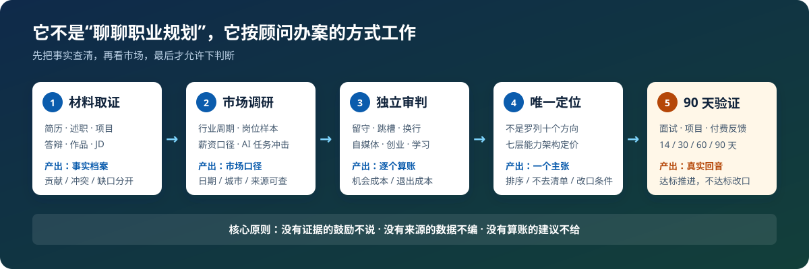
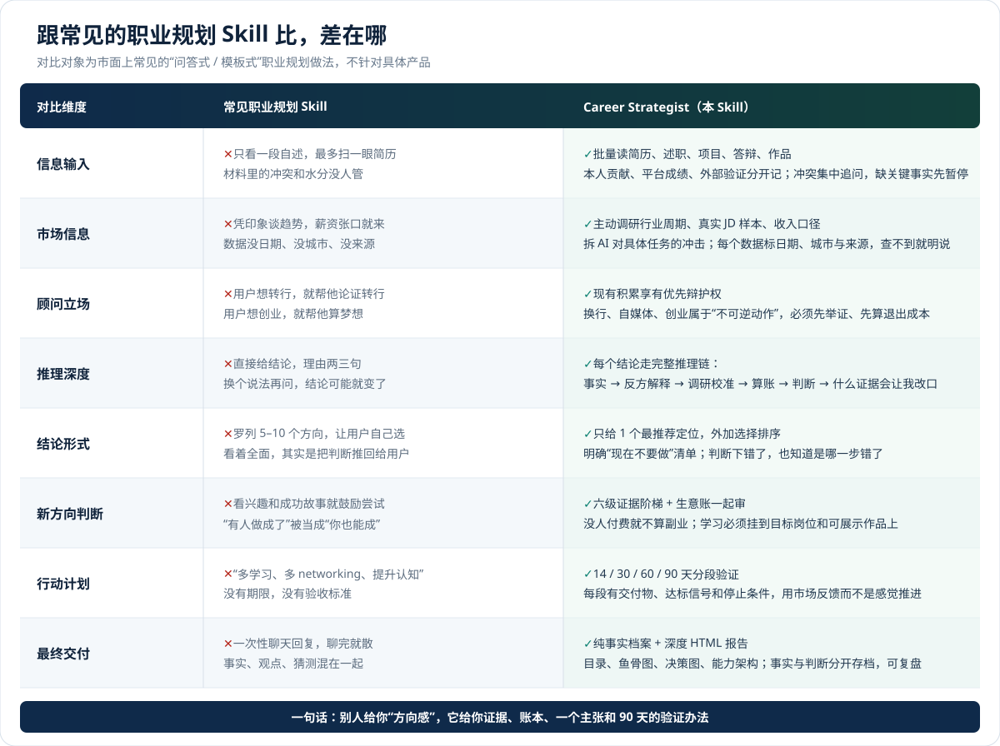

# Career Planner

> It does not hand you ten possibilities. It establishes the facts, then names the one direction worth the bet.


Career Planner is a career-planning skill for any industry. It reads a resume, reviews, projects, defense materials, and a portfolio. It researches the industry, real jobs, pay, and the impact of AI in the user's own labor market. It then delivers:

- one clear position for the next stage;
- a call on whether to stay, move internally, change companies, switch industries, or keep exploring;
- a main plan, a backup, and the evidence that would change the call;
- actions that can be checked at 14, 30, 60, and 90 days;
- a long HTML report meant to be sat down and read.

The listing cover is `demo/cover-512.png` (512×512).

## How it works

Most career tools are a conversation that agrees with you and ends in encouragement plus a list of directions. Career Planner works the way a senior advisor works a case. **No evidence, no opinion. No ledger, no bet.**



Five steps, each with an output:

1. **Evidence.** It does not only listen. It reads the resume, reviews, projects, defense materials, portfolio, and target job descriptions in one pass. Personal credit, results borrowed from the platform, and outside verification are recorded separately. Conflicts are asked about together. If a fact that would flip the conclusion is missing, the report stops instead of guessing.
2. **Market.** It does not talk about trends from impression. It checks the industry cycle, what real jobs actually hire for, how pay is defined, and which daily tasks AI is already eating. Every figure has a date, a place, and a source. What cannot be checked is said out loud.
3. **An independent judgment.** It does not echo. Existing accumulation gets the benefit of the defense. A career switch, a creator business, or a startup is hard to undo, so it has to pass evidence and a ledger. Enthusiasm is not evidence.
4. **One position.** It does not offer ten directions and leave the choice with you. It gives one recommended position, says why it is worth money, which evidence is still missing, and which lookalike roles to avoid.
5. **A 90-day test.** The conclusion is not a life sentence. Interviews, projects, and payment are the checkpoints. Meet them and continue. Miss them and the call changes. The condition for changing it is written in advance.

## Why it exists

A lot of career advice ends as one of three useless things:

- a repeat of what the person already knows;
- every option laid out flat, so the person still has to decide;
- "raise your awareness, build a brand, embrace AI" in place of a judgment.

This skill works the other way:

1. **Take evidence first**, from the person's account and from the career materials: facts, results, personal credit, and conflicts.
2. **Then research** real jobs, the local definition of pay, industry change, and what AI does to specific tasks.
3. **Then judge**: the current situation, stay or go, and one recommended position.
4. **Test it cheaply**, and update the conclusion from market feedback, interviews, payment, and project results.

It has a point of view, and it does not pretend to know everything. Facts, market data, inference, and hypotheses still to be tested are labeled. Every core judgment walks a full chain: what the facts are, what else could explain them, which explanation the research supports, what the other choice would cost, what to do now, and what new evidence would make the advisor change the call.

The report keeps the design quiet. It is closer to a long conversation with someone who has watched industries rise and fall. It prices the current job's value and its cost before discussing whether to leave. It asks for the base rate, the business ledger, and the real Tuesday of a new direction before it talks about passion and freedom. While the existing accumulation still has value, a career switch, a creator business, or a startup has to pass the evidence first.

## Compared with a typical career skill

The figure below is the whole gap at once. The comparison is with common question-and-template career tools, not with a named product.



| Dimension | A typical career skill | Career Planner |
| --- | --- | --- |
| Input | A short self-description, maybe a glance at the resume. Conflicts and padding are ignored. | Reads the resume, reviews, projects, defense, portfolio, and target job descriptions. Separates personal credit, platform results, and outside verification. Asks about conflicts together. Stops if a decisive fact is missing. |
| Market | Trends and salaries from impression. No date, no place, no source. | Researches the cycle, real job samples, the pay definition, and the AI impact on specific tasks. Every figure has a date, a place, and a source. What cannot be checked is said. |
| Stance | If you want to switch, it argues for the switch. If you want a startup, it prices the dream. | Existing accumulation gets the defense. A switch, a creator business, or a startup is hard to undo and has to show evidence and an exit cost. |
| Reasoning | A conclusion and two sentences. Ask another way and the answer may change. | Every core conclusion walks fact, the other explanation, research, the ledger, the call, and what would change the call. |
| Conclusion | Five to ten directions, and the choice is handed back. | One recommended position, a ranking, and a list of what not to do now. If the call is wrong, you can see which step failed. |
| New paths | Interest and a success story are treated as "you can do it too." | A six-step evidence ladder plus the business ledger. No payment, no side income. Study has to attach to a target role and an artifact that can be shown. |
| Action | "Learn more. Network more. Raise your awareness." No deadline and no test. | 14 / 30 / 60 / 90 days, each with a deliverable, a pass signal, and a stop condition. |
| Delivery | One chat reply. Facts, opinions, and guesses are mixed. | A fact dossier plus a long HTML report with a table of contents and diagrams. Facts and judgments are stored apart, and can be reviewed later. |

**Others offer a feeling of direction. This offers evidence, a ledger, one claim, and a 90-day way to test it.**

## The questions it answers

| What the person actually asks | What the report answers |
| --- | --- |
| Why do I suddenly want a different direction? | The surface trigger, the underlying need, and the real contradiction |
| Should I stay or leave? | A clear call, the reasons, the risk, and what would reverse it |
| What should the next seat be? | One recommended position, a 1-year bridge, and a 3-year target |
| What is my market price? | The target labor market, job samples, a pay range, and the definition of that pay |
| Will AI affect me? | Down to specific tasks, quality ownership, and the industry's process |
| Is a creator business or a startup real? | Demand, payment, repetition, unit economics, and a spending cap |
| What should I learn? | Target role, then the gap, then an artifact, then market feedback |
| What do I do next? | A 14/30/60/90 day test, with stop conditions |

## It does not only read a resume

A person can send, in one batch:

- a resume or a career timeline;
- performance reviews, promotion packets, and retrospectives;
- project documents, defense decks, and close-out notes;
- a portfolio, research, proposals, and cases;
- target job descriptions, offers, and recruiter notes;
- client feedback, creator analytics, orders, and operating records.

The skill first lists facts in hand, conflicts between materials, and what is still missing. If a missing fact would change the conclusion, it pauses and asks the questions together, instead of filling the gap with a guess.

## Built for "the job is fine, and I want to do something else"

When the work, the pay, or the outlook is unsatisfying, and a creator account, a startup, a certificate, or a new skill appears, the skill does not cheer and it does not simply talk the person out of it.

It places the new direction on a six-step ladder:

`interest → steady output → outside demand → first payment → it repeats → a business that continues`

Interest, views, and certificates are signals. They are not automatically a career. The report judges separately:

- whether the current path can be repaired;
- whether an adjacent move fits;
- how to test the new direction on the side;
- when, if ever, a full-time bet is earned.

## A position is not a job title

The position uses one sentence across industries:

> Someone who, in [an industry or setting], solves [a high-value problem] for [the person served], lands [professional skill or a new tool] in [a real process], and is accountable for [quality, efficiency, revenue, risk, or experience].

Every industry is scored on the same seven layers, then translated into that industry's language:

1. Problem definition and professional judgment.
2. Process and tool orchestration.
3. Decision rights and risk boundaries.
4. Quality verification and a feedback loop.
5. Resource and system tradeoffs.
6. Service delivery and experience.
7. From a pilot to scaled adoption.

Technology, manufacturing, education, healthcare, sales, and design share the skeleton. They do not share the conclusion. A technical example shows the method. It does not steer a non-technical person toward an AI or engineering job.

Research uses the labor market the person is actually in. Default sources are LinkedIn, Indeed, Glassdoor, Levels.fyi, Wellfound, Blind, Welcome to the Jungle, national statistics (such as U.S. BLS or U.K. ONS), and labeled recruiter salary guides. Pay is written in the local currency and the local definition: base, bonus, equity, and benefits stay separate.

## What it delivers

By default:

```text
career-plan/
├── fact-dossier.md             # facts only
├── career-strategy-report.html # one long report
└── summary.md                  # optional
```

The HTML report has two parts:

- **The career plan:** situation, motive, the experiment, the market, stay or go, the position, the capability gap, and 90 days of action.
- **Personal facts:** history, projects, results, money, constraints, sources, and gaps.

The report is set like a paper essay: a narrow measure, generous line spacing, continuous argument. Tables are for comparisons such as job samples. A clickable table of contents sits near the top. The stay-or-go call, the position, and the 14-day action are pulled into dark panels. Four diagrams are allowed, one each: a fishbone for the root problem, a decision flow for the order of bets, an evidence ladder for how far a new direction has actually gone, and a capability stack for why the next job is worth more. Long paragraphs bold the key judgment, and each chapter highlights at most one sentence. Four restrained human moments sit in fixed places: a fair word at the opening, a relieving word after the motive, a grounding word before the action, and a short letter at the end. Each one has to hang on a specific fact. There is no privacy mask. Before sharing, delete income, health, and family details you do not want public.

## The sample report

Open this file in a browser:

```text
demo/career-strategy-report.demo.html
```

The sample uses a fictional consumer-brand manager in a major metro, with fictional U.S. dollar pay. Companies, projects, market figures, income, and savings are invented. They show the method and the page. A real report uses the reader's country, currency, and labor market.

## Try asking

```text
Read my resume, reviews, and project materials, and recommend the career position I should aim at for the next three years.
```

```text
The job has stopped teaching me anything, and I am trying a creator account. Should I stay, change jobs, or keep exploring?
```

```text
I want to change fields and I do not know the cost. Use real jobs, pay, and the AI impact in my target city, and give me an objective plan.
```

## Layout

```text
career-planner/
├── SKILL.md
├── README.md
├── references/
│   ├── intake-questionnaire.md
│   ├── expert-analysis-framework.md
│   └── market-ai-research.md
├── templates/
│   ├── fact-dossier-template.md
│   └── report-template.html
└── demo/
    ├── cover-512.png
    ├── career-strategy-report.demo.html
    ├── methodology.svg
    └── comparison.svg
```

## Limits

- No clinical, medical, or legal judgment.
- It does not invent jobs, pay, industry trends, or success rates.
- If a job board cannot be checked directly, it says so.
- The conclusion updates when the person's facts or the market change.
- Redact first. Do not upload trade secrets or personal data you have no right to share.

---

**The value of a career plan is not a prediction of one certain future. It should show the chips you hold, name the bet most worth making, and test it at the lowest cost.**
